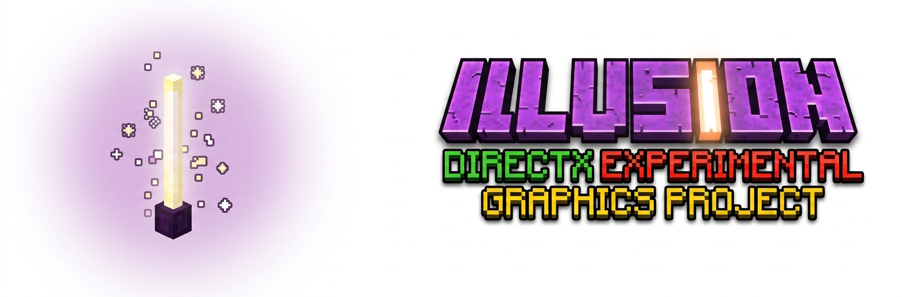

 

 

 

 

# DirectX Minecraft Graphics Experimental Project

[English] | [[简体中文](docs/README_ZH.md)]

> [!CAUTION]
> This is an experimental project that may never be introduced to a real production environment.
>
> To put it bluntly, what this project does is basically "blindly chasing the newest things": introducing as many new features as possible, provided that it can run.

## Illusion

### Origins

At the beginning, the author basically just wanted to make something like Radiance, only specialized for the Windows platform. 
After realizing how incapable `wgpu` is, he gave up on setting any more flags for [Neolectrum](https://github.com/NTS-Official/wgpu-mc-neo). 
Then the author discovered [DirectXMod](https://github.com/366862732/DirectXmod), his brain went into overdrive and produced a few mysterious ideas, and he decided to do something. 
Since the original project is a rather hard-to-watch exercise in wish-driven programming (it even puts Minecraft's own source code into the repository), this project likewise keeps developing most of its code in the style of **vibe coding**. Real people only handle planning the architecture, the non-existent code review, and pressuring the AI into fixing bugs (not really).

### Introduction

> [!WARNING]
> This mod is still in early development; it is yet another of the [author](https://github.com/NTS-Official)'s [hole-digging projects that may never be finished](https://github.com/NTS-Official/wgpu-mc-neo).

Illusion is a Minecraft NeoForge mod based on Microsoft's DirectX 12 backend, aiming to bring advanced graphics features to Minecraft — ray tracing (not implemented), mesh shaders, temporal anti-aliasing, NVIDIA's whole Streamline suite (deep learning super sampling, frame generation, ray reconstruction and ray denoising), and more. 
It also takes advantage of DirectX's strengths on the Windows platform and Microsoft's PIX diagnostic tools to create an experimental platform that is easy to develop on.

## MCDR

### Overview

Because it learns from (copies) Radiance, the project is organized the same way: the dynamic link library lives in its own repository, named **[MCDR](https://github.com/NTS-Official/MCDR)** — a rather hasty decision, to be honest.

## Documentation

The design documents live in [`docs/`](docs/overview.md), written in Simplified Chinese. Start with the overview: it lists every subsystem and what each document covers. 
Source comments keep only the constraints that bite when you read the code; design intent, data flow and the reasons behind the architecture are in the documents.

## Details

- [DirectXMod](https://github.com/366862732/DirectXmod) was implemented with JNI. Following the changes in Minecraft 26.1 — the game dropped deobfuscation and upgraded Java 21 to Java 25 LTS, the first LTS release after the FFM API left preview — this project replaces the whole JNI implementation with the [Java FFM API](https://docs.oracle.com/en/java/javase/21/core/foreign-function-and-memory-api.html), which is theoretically faster and makes calling and implementing native code safer and easier.
- Since release-26.3, the game has switched from LWJGL to SDL, which makes it easier to wrap the backend presentation (26.4-snapshot-5 already introduced a native DXGI-wrapped presentation path). This mod therefore gives up on 26.2 and raises its target Minecraft version to release-26.3 for the next stage of development.

# Acknowledgments
This is the acknowledgements part of the project DXRMC.

> [!NOTE]
> ### CC0
>
> Part code of this project was modified from [DirectXMod](https://github.com/366862732/DirectXmod), whose author is [xiaozi](https://github.com/366862732).

## References
[VulkanMod](https://github.com/xCollateral/VulkanMod)、[Radiance](https://github.com/Minecraft-Radiance/Radiance) & [MCVR](https://github.com/Minecraft-Radiance/MCVR)、[C2ME](https://github.com/RelativityMC/C2ME-fabric)、[Bye-Pregen](https://github.com/MoePus/Bye-Pregen) were referred as some extraordinary examples of implementation in this project. Tribute to these developers who contribute to community selflessly!

## External libraries
- This project uses [Microsoft's DirectX 12 Ultimate technology](https://devblogs.microsoft.com/directx/announcing-directx-12-ultimate/). Please refer to [this page](https://learn.microsoft.com/zh-cn/windows/win32/direct3d12/what-is-directx-12-) for more information.
- This project uses [NVIDIA's DLSS (Deep Learning Super Sampling) technology](https://www.nvidia.com/en-us/geforce/technologies/dlss/). Please refer to [this page](https://github.com/NVIDIA/DLSS) for more information.
- This project uses [AMD's FSR technology](https://www.amd.com/zh-cn/products/graphics/technologies/fidelityfx/super-resolution.html). Please refer to [this page](https://gpuopen.com/amd-fsr-sdk/) for more information.
- This project uses [Intel's XeSS technology](https://www.intel.cn/content/www/cn/zh/products/docs/discrete-gpus/arc/software/gaming-technologies.html). Please refer to [this page](https://github.com/intel/xess) for more information.

Only the Intel XeSS runtime ships inside the mod JAR. The NVIDIA DLSS and AMD FidelityFX runtimes are not redistributed: a released build reports those SDKs as unavailable unless you place the vendor DLLs next to `MCDR.dll` yourself, and development builds stage them into `run/dxrmc/` via `gradlew copyVendorDlls`. 
Special thanks to all contributors of open-source libraries used in this project. If any are not credited and should be, please inform the author and credit will be applied where required.

# Disclaimer
This is a community-made third-party mod and is not affiliated with, authorized, sponsored, endorsed by, or otherwise officially connected to Mojang Studios or Microsoft. A commonly used wording on mod platforms is: "NOT AN OFFICIAL MINECRAFT SERVICE. NOT APPROVED BY OR ASSOCIATED WITH MOJANG OR MICROSOFT." 
Minecraft and related names, logos, and assets are trademarks and/or intellectual property of Mojang Studios and/or Microsoft. 
This project is also not affiliated with, sponsored by, or endorsed by NVIDIA. NVIDIA / GeForce / RTX / DLSS are trademarks of NVIDIA Corporation and remain the property of their respective owners. 
This mod is provided "AS IS" without warranties. You assume all risks arising from its use (including, but not limited to, crashes, visual issues, data loss, or incompatibilities with other mods). Please back up your worlds and configs before installation.
